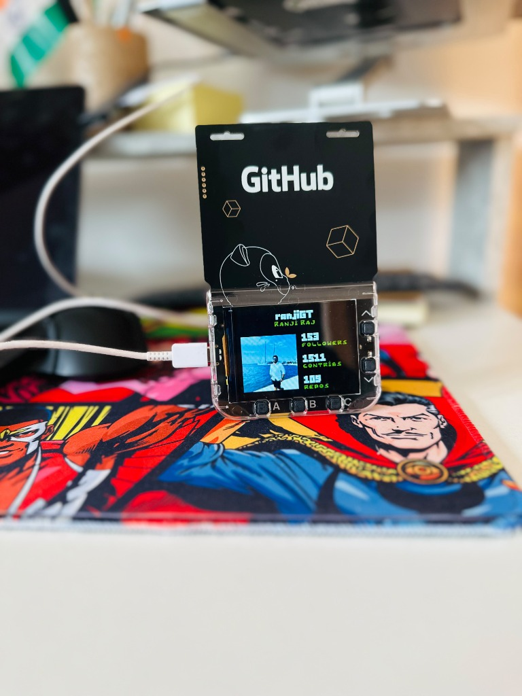
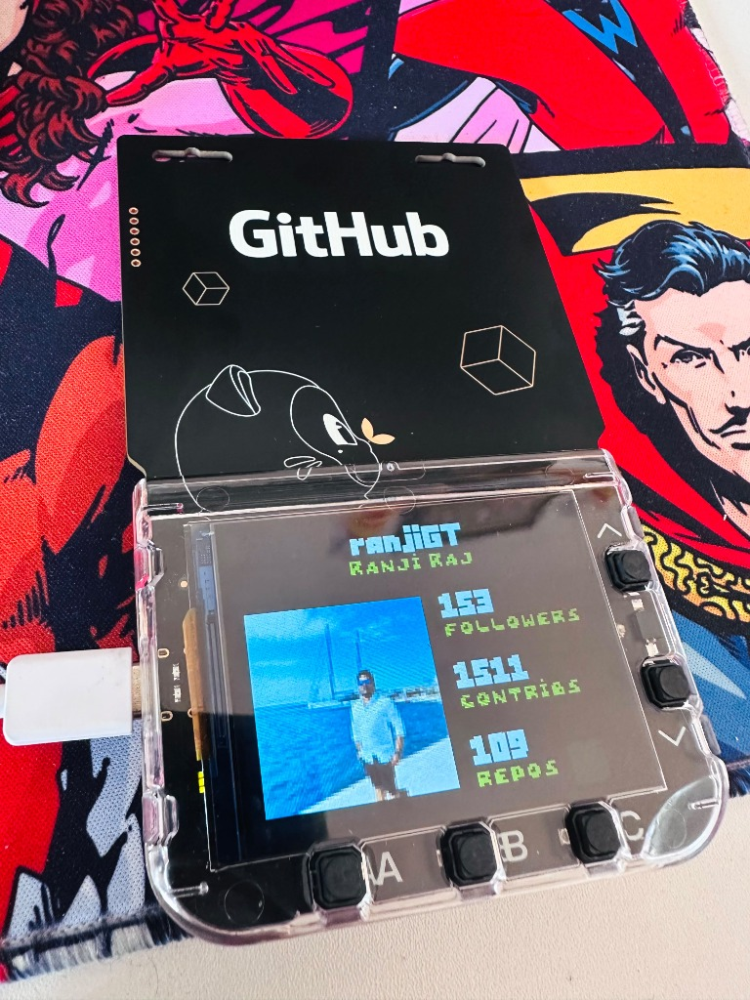

<h1 align="center">Ranji Raj</h1>

  <strong>Data scientist · automation engineer · educator</strong> 
  M.Sc. Data Science · Applied AI and learning tools · Frankfurt, Germany

  
  
  

  <a href="#about">About</a> ·
  <a href="#github-in-the-real-world">GitHub in the real world</a> ·
  <a href="#certifications">Certifications</a> ·
  <a href="#recent-lessons">Videos</a> ·
  <a href="#open-source">Open source</a> ·
  <a href="#github-achievements">Achievements</a> ·
  <a href="#github-activity">GitHub activity</a>

---

## About

> **Ran** rhymes with **run**; **ji** is pronounced like the letter **G**.

I have 6+ years in automation engineering and create practical learning content on data science, deep learning, and applied AI. I’m currently exploring neural networks, LLMs, and MLOps.
I’m part of the team at Lufthansa Systems, within Lufthansa Group, working on
GitHub solutions. Senior product owners from Lufthansa Systems and Lufthansa
Group discussed this work at the Developer Conference on June 11, 2026.

**Ask me about:** Python, deep learning, ML pipelines, and data visualization. 
**Fun fact:** I can explain backpropagation to a 10-year-old.

  
  
  

## GitHub in the real world

My GitHub Universe Conference badge from 2025, customized to display my GitHub profile stats.

<table>
  <tr>
    <td width="50%" align="center">
      
       <strong>The badge</strong> · my GitHub Universe 2025 keepsake
    </td>
    <td width="50%" align="center">
      
       <strong>Up close</strong> · profile stats on the badge display
    </td>
  </tr>
</table>

## GitHub activity

  

## Certifications

  

  <strong>GitHub Copilot (GH-300)</strong> 
  Earned 3 August 2026 · Expires 4 August 2028 
  Credential ID: <code>D31588F9563F3F39</code> 
  Certification number: <code>A36Y6D-141E37</code> 
  <a href="https://learn.microsoft.com/en-us/credentials/certifications/github-copilot/">Certification details on Microsoft Learn</a>

## Recent Lessons

<!-- BEGIN YOUTUBE-CARDS -->

<!-- END YOUTUBE-CARDS -->

---

## Open source

| Project | Contribution | Impact |
|---|---|---|
| [nteract/testbook](https://github.com/nteract/testbook) | [Bug report: Return value as None from testbook function](https://github.com/nteract/testbook/issues/143) | Found a bug in the `@testbook` decorator that returned `None` instead of the actual value. Led to fix in [PR #145](https://github.com/nteract/testbook/pull/145). |
| [jupyterlab/jupyterlab](https://github.com/jupyterlab/jupyterlab) | [Answered: How to center text in markdown and export it to PDF](https://github.com/jupyterlab/jupyterlab/discussions/16687) | Provided the accepted answer explaining that Pandoc ignores `
` HTML tags during PDF (LaTeX) conversion, with the correct raw LaTeX and Pandoc Markdown alternatives. |

---

## GitHub achievements

Explore earned public badges, level progress, and merged pull request activity for any GitHub username.

  

### Verified profile badges

Achievements currently visible on the [ranjiGT GitHub profile](https://github.com/ranjiGT?tab=achievements):

  
  
  
  
  
  
  

The catalog looks up a username once, then shows public achievements parsed from that user's GitHub profile. Pull Shark merged PRs are fetched automatically; enter activity counts manually for other badges. GitHub does not expose most achievement counters through its public API, and level thresholds are community-reported estimates.

The Achievement activity breakdown summarizes each current badge, its qualifying activity, current count, level, and remaining activity to the next level. The table updates when you edit a badge's activity count or run the username lookup.

Achievement inventory is read server-side from the public GitHub profile HTML; private or hidden achievements cannot be shown.

The catalog also recognizes the rare Proxima Pioneer, Proxima Staffshipper, and Proxima Staffuser badges when they appear on a public profile. GitHub labels these as internal achievements, so the catalog does not assign them public progress targets.

Developer setup and deployment

Run `npm install` and `npm test` for parser checks. For a complete frontend and API preview, install the [Vercel CLI](https://vercel.com/docs/cli) and run `vercel dev`.

---

Developer joke

  

